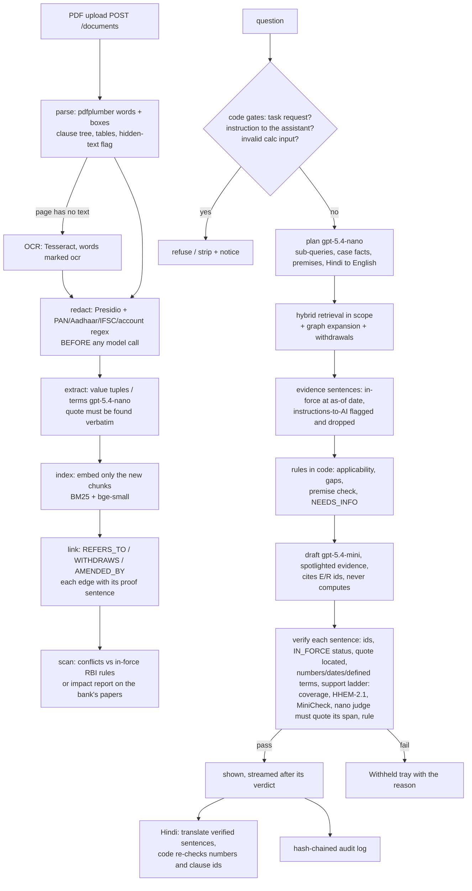

# Proof-or-Silence: zero-guessing document AI for a co-operative bank (Hackasol 5.0 · AIML-02)

Answers compliance questions across RBI circulars, Master Directions and a bank's own loan documents **only with
verified evidence**. It works out which version of a rule applied on a given date, flags contradictions between
documents, and says *"I don't have proof"* instead of guessing. A judge can upload their own PDF.

> **Core principle:** the language model only drafts and extracts. Our code decides what the user sees: every shown
> sentence passed quote, in-force, number and support checks; anything unproven goes to a visible "Withheld" tray.

Persona: the compliance officer of *Example Urban Co-operative Bank Ltd.*, a **fictional** Tier 3 UCB. Bank documents
in `corpus/synthetic/` and the demo sets in `corpus/demo/` (a bank circular for the upload demo; a "Suraksha Health"
insurance policy, endorsement and claim FAQ) are fictional and marked so. RBI documents are © Reserve Bank of India and
are not committed; `corpus/MANIFEST.csv` lists URLs and checksums. The shipped corpus is **15 RBI documents + 7
fictional bank documents (22)**; a 16th downloaded RBI file, KFS Annex A (a blank form template with no rules), is left
out on purpose.

## Verification pipeline



The "graph" is two SQLite tables: `edges` (each with a located quote) and `provision_versions` (valid_from /
valid_to). In-force status is computed at the as-of date, never stored.

## What is distinctive
1. **Date-aware verification.** A cited quote must be in force on the as-of date, not merely present in the PDF.
   Versions are rebuilt from RBI's footnotes, repeal annexes, withdrawal circulars and (for uploads) amendment or
   endorsement sentences. Removing this check lets 18 wrong "current law" sentences through in 16 answers (ablation).
2. **Code-side applicability and premise checks.** Tier, borrower, purpose, amount and sanction date are compared
   with each rule's conditions in code, with gaps detected (no paragraph covers a loan sanctioned on 31 Dec 2025). A
   question's false premise is rejected from an applicable rule finding; missing case facts come back as NEEDS_INFO.
3. **Contradiction triage** (conflict / supersession / different condition / consistent) on typed value tuples, in
   code. In general mode the same idea works on free-text terms (insurance waiting periods).
4. **Injection defence in three layers:** instructions in the question are stripped with a visible notice;
   sentences in documents that address an AI (including hidden white text) are flagged and never used; output that
   talks about the assistant or its ids is blocked.
5. **Impact alert + maker-checker + tamper-evident audit.**
6. **Verified summaries and follow-ups.** "Summarise this document" picks evidence from the document's own sections
   and checks every key point like any answer; "what about Tier 4?" is rewritten into a full question (shown to the
   user) before the normal pipeline runs. Greetings get a fixed help card with no model call.

## Results (replayed from recorded model calls, $0; `eval/reports/critical/final_pass.json`)

| Set | Before the final pass | Now |
|---|---|---|
| 114 gold questions (dev 50, held-out test 30, fresh 34 written by a stronger model) | 101 (88.6%, CI 81.5–93.2) | **102 (89.5%, CI 82.5–93.9)**, 0 hallucinated |
| Red-team (22 attacks: injection, false premise, superseded traps, number traps, PII, homoglyphs, poem, guarantee, commercial-bank profile) | 16 pass, 3 flagged hallucinated | **22 / 22** |
| Hindi questions (8) | 7 / 8, answered in English | **8 / 8**, Hindi shown beside the English; 20/20 translated sentences passed the code check |
| Sentences not supported by their cited span (independent gpt-5.4-mini audit, Stanford "misgrounded") | 3.6% (10/275) | **2.8% (7/247)** vs 10.6% for plain RAG |
| Quotes not found on their cited page | 0 / 375 | 0 (deterministic check, every run) |
| Upload demo (2) · insurance demo (4) | — | 2/2 · 4/4 |

Other measured numbers (from `reports/Banking judge critique and evals.md`): contradiction precision 0.93 / recall
0.81; 19/19 unanswerable or out-of-scope questions handled; hybrid retrieval hit@8 0.92; cost ≈ $0.0045 (₹0.38) per
answer; warm local work 1.1 s p50 (live answers 7–15 s; `/ask/stream` shows stage progress meanwhile).
First-draft pass rate (share of drafted sentences that survived) moved dev 0.74 → 0.76, test 0.71 → 0.76, fresh
0.85 → 0.75, red-team 0.68 → 0.57: the new prompt is not better everywhere; the verifier keeps the output safe either way.
A strict regex grader and an LLM judge agree only 73% on the fresh set (κ 0.17); the two-person blind check of 20
items is still a team task.

## Models and licences

| Component | Role | Licence |
|---|---|---|
| OpenAI `gpt-5.4-mini-2026-03-17` | drafting; tuple audit | API (organizer-approved, see below) |
| OpenAI `gpt-5.4-nano-2026-03-17` | query plan, value/term extraction, search prefixes, 3rd-tier judge (≤3 per answer), Hindi translation | API |
| `vectara/hallucination_evaluation_model` (HHEM-2.1-Open) | entailment, support step 1 | Apache-2.0 |
| `lytang/MiniCheck-DeBERTa-v3-Large` | entailment second opinion | MIT |
| `BAAI/bge-small-en-v1.5` | embeddings, retrieval, term matching | MIT |
| Tesseract OCR 5 (`eng`) | scanned pages in uploads | Apache-2.0 |
| Microsoft Presidio + spaCy `en_core_web_sm` | PII redaction | MIT |
| pdfplumber, pypdf, bm25s, rapidfuzz, sentence-transformers, FastAPI, python-multipart, reportlab | parsing, search, matching, API, demo PDFs | MIT / BSD / Apache-2.0 |

**About OpenAI, honestly.** The problem statement asks for open-source models; the organizers allowed an OpenAI key for
this event. Every checker, the search, OCR and redaction are open source and run locally; only drafting, extraction and
translation call OpenAI, with redacted text, `store=false` and pinned model ids. The same code runs on an on-premises,
open-weight model by setting `LLM_BASE_URL` (any OpenAI-compatible server such as vLLM or Ollama) plus
`LLM_MODEL_DRAFT` / `LLM_MODEL_EXTRACT`; then nothing leaves the bank. We have not measured quality on an open-weight
model. See `docs/PRIVACY.md`.

## Run it

```bash
make setup                       # venv, requirements, spaCy model (Tesseract: brew install tesseract)
make manifest synthetic ingest   # RBI PDFs from ~/Downloads (links in corpus/sources.csv) + fictional bank docs
.venv/bin/python corpus/demo/build_demo_pdfs.py
.venv/bin/python corpus/demo/load_demo.py insurance     # pre-load the fictional insurance set (replays at $0)
cd backend && LLM_MODE=replay ../.venv/bin/uvicorn app.api:app --port 8000   # http://127.0.0.1:8000/docs
```

- `LLM_MODE=replay` answers only recorded questions (no network, $0); `live` calls the model on a cache miss.
- `SPEND_CAP_USD` hard-stops spending; the key is read from `LLM_KEY_FILE` (default `~/Janmitra/.env`), never printed.
- `PROMPTS=v1` switches back to the pre-final-pass prompts (still replayable); default `v2`.
- `UPLOADS_ENABLED=0` switches uploads off; `UPLOAD_MAX_PAGES` (40), `UPLOAD_MAX_MB` (20).

**Upload a PDF:** `curl -F file=@my.pdf -F doc_kind=bank_policy http://127.0.0.1:8000/documents` → poll
`GET /documents/{id}/status` → ask with `{"question": "...", "upload_ids": ["UP-…"]}`. `doc_kind`: `rbi_circular`,
`bank_policy`, `loan_agreement`, `kfs_or_sanction` or `other` (general mode). Uploads are searched only when named,
and `DELETE /documents/{id}` removes one completely. Every new field and endpoint is listed in `docs/API_CHANGES.md`.

Main endpoints: `POST /ask`, `POST /ask/stream` (SSE), `POST/GET/DELETE /documents`, `GET /documents/{id}/status`,
`/documents/{id}/pdf`, `/documents/{id}/pages`, `POST /rules` (rule simulator), `GET /conflicts`, `POST /impact`,
`GET /provisions/{chunk_id}/timeline`, `GET /review-queue`, `POST /review/{id}` (maker ≠ checker),
`GET /trace`, `GET /trace/verify-chain`, `POST /incidents`, `GET /obligations`, `GET /health`.

## Tests and evaluation

```bash
make test    # 48 unit + API tests, no model calls (uploads, OCR, guards, SSE, Hindi check, insurance chain,
             # summaries, follow-ups, small talk)
make gate    # 14 canary questions in replay mode, $0
LLM_MODE=replay .venv/bin/python eval/critical_capture.py --sets dev,test,fresh --out NAME   # full instrumented run
.venv/bin/python eval/run_eval.py dev|test --workers 1        # Stanford-style labels, Wilson CIs
```
Gold: `eval/gold.jsonl` (80), `eval/fresh_test.jsonl` (34), `eval/redteam.jsonl` (22), `eval/hindi.jsonl` (8),
`eval/demo_extra.jsonl` (upload + insurance, 6). Full critique, ablations and industry comparison:
`reports/Banking judge critique and evals.md`.

## Known limitations
- **Cloud drafting by default** (see above). Names in questions are not redacted (the name detector misfires).
- **Answers can be incomplete rather than wrong:** 12 of 114 gold items are Incomplete (over-refusal on some table and
  contradiction questions). The verifier trades hallucination for silence.
- **English-only checkers.** Hindi works by translating the question and the verified answer; Hindi source documents
  are not ingested, and the translation check covers numbers and ids, not meaning.
- **Confidence label** (`confidence.level = low` below 1 in 3 drafted sentences proven) is a caution label: on our
  114 items it barely separates right from wrong (1 of 10 below the cut wrong vs 8 of 90 above).
- **Premise check** is heuristic for numbers (it reports "not found in the searched documents", not "false").
- **General mode** compares term values, not their conditions, and has only been tried on the fictional insurance set.
- **Uploads:** PDF only, ≤ 40 pages, English OCR only (no Hindi Tesseract pack installed), one at a time.
- **Value tuples** are model-extracted and audited, still imperfect; bank loan scope for the shipped fictional
  documents comes from `corpus/synthetic/scope.json`.
- **Latency:** 7–15 s live per answer (stream it); replay is ~1 s.
- Docling was dropped (pdfplumber only); the cross-encoder reranker is implemented but off (no gain on dev).
